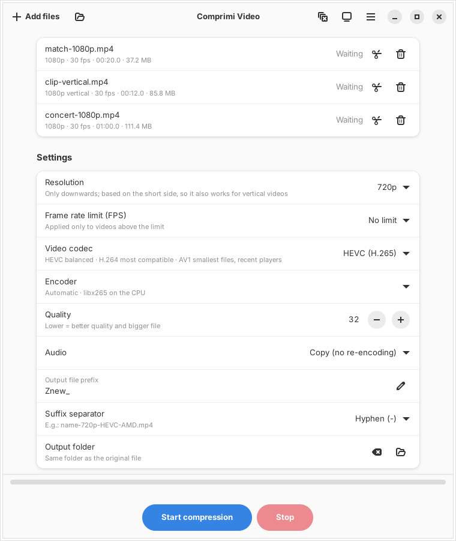
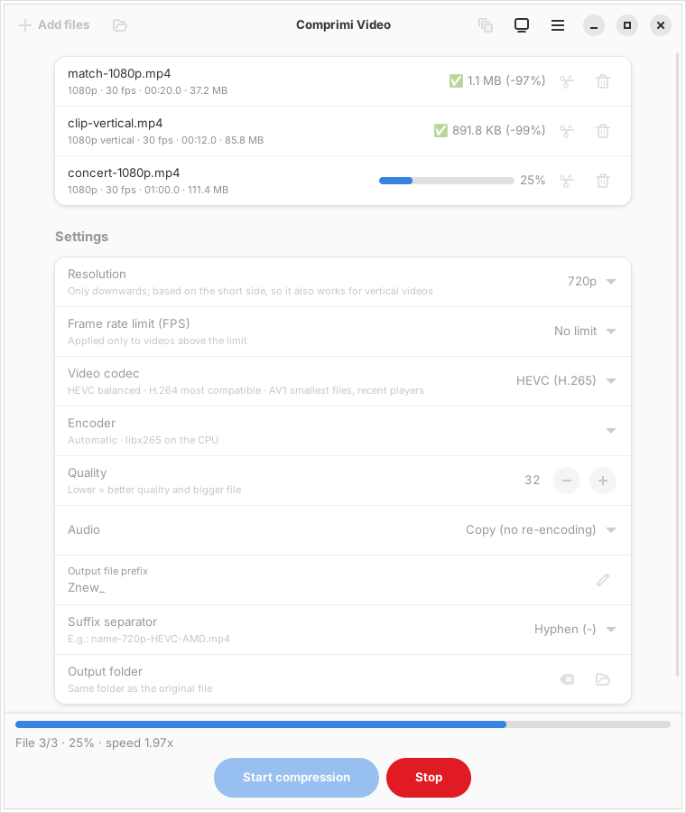

<p align="center">
  
</p>

<h1 align="center">Comprimi Video</h1>

<p align="center">
  Reduces the size of videos with ffmpeg — HEVC, H.264 or AV1 —<br>
  on the graphics card (AMD, Intel, NVIDIA) or on the CPU.
</p>

<p align="center">
  <a href="README.md">Italiano</a> · <b>English</b>
</p>

<p align="center">
  
</p>

*Comprimi Video* is Italian for "compress video". The interface is in English and Italian:
it follows the system language and can be changed from the main menu (☰ → Lingua / Language).

## What it does

- **Finds the hardware by itself**: it detects the graphics cards and really tests every encoder
  with a few frames, so it uses the GPU when it works and the CPU when there is nothing else.
  The result is remembered until drivers, cards, ffmpeg or kernel change.
- **Three codecs**: HEVC (good balance), H.264 (most compatible), AV1 (smallest files).
  The menu only shows the ones the computer can produce.
- **Resizes and limits the frame rate**, only downwards; the resolution is based on the short side,
  so a vertical phone video at "720p" becomes 720×1280.
- **Cuts parts out** before compressing, with a preview of the result.
- **Works in batches** on many files or whole folders, also by dragging them into the window
  or with "Open with" from the file manager.
- **Takes care of the audio**: it copies it as it is, or re-encodes it to AAC
  when the original format does not fit in an MP4.

<p align="center">
  
</p>

## Download and install

Download the AppImage from the [Releases](https://github.com/cello59-lab/comprimi-video/releases) page
and put it wherever you like, for example in `~/opt`:

```bash
mkdir -p ~/opt
mv ~/Downloads/Comprimi_Video-*-x86_64.AppImage ~/opt/
chmod +x ~/opt/Comprimi_Video-*-x86_64.AppImage
~/opt/Comprimi_Video-*-x86_64.AppImage --install-menu
```

From then on Comprimi Video opens from the applications menu. The entry points to the AppImage
file: if you move it, run `--install-menu` again. To remove it: `--remove-menu`.

The AppImage contains everything it needs (ffmpeg, GTK4, libadwaita, GStreamer):
there is nothing else to install.

### Requirements

- Linux x86_64 with **glibc 2.39 or newer**: Ubuntu 24.04 and later,
  Linux Mint 22 and later, Debian 13, Fedora 40 and later.
- For GPU compression, the card drivers:
  - **AMD and Intel**: VA-API drivers (usually already there; on Ubuntu `mesa-va-drivers`
    for AMD, `intel-media-va-driver` for Intel);
  - **NVIDIA**: the proprietary driver (NVENC is not available with the free *nouveau* driver).

Without a usable GPU the compression runs on the CPU: it always works, just more slowly.

## Usage

1. Add videos with **Add files**, with the folder button or by dragging them into the window.
2. Choose resolution, codec and quality (lower = better quality and bigger file).
3. If you want, press the **scissors** on a video to cut parts of it out.
4. Press **Start compression**.

The produced files end up next to the originals (or in the chosen folder) with a name
that says what was done, for example `Znew_match-720p-HEVC-AMD.mp4`
(resolution, codec, where it was encoded: `AMD`, `INTEL`, `NVENC` or `CPU`).

The button with the monitor shows the cards found and the working encoders,
and lets you repeat the tests.

## From the terminal

```bash
comprimi-video --detect                      # graphics cards and working encoders
comprimi-video --cli video.mp4               # compresses without opening the window
comprimi-video --cli --codec av1 --resolution 1080 --fps 30 ~/Videos/match/
comprimi-video --cli --cut 0:00-0:30 --cut 9:10-9:50 game.mp4
comprimi-video --cli --encoder libx265 video.mp4   # forces an encoder
comprimi-video --help                        # all the options
```

The messages follow the language of the interface. The AppImage works the same way:
`Comprimi_Video-*-x86_64.AppImage --detect`.

## Building from source

On Ubuntu 24.04 or later:

```bash
sudo apt install cargo libgtk-4-dev libadwaita-1-dev ffmpeg libgtk-4-media-gstreamer \
                 gstreamer1.0-plugins-good gstreamer1.0-libav
cargo build --release
./target/release/comprimi-video --install-menu
```

Rust 1.92 or newer is needed (use [rustup](https://rustup.rs) if the one of your distribution is older).
Tests: `cargo test`.

The source code and its comments are in Italian. The English texts of the interface are in
[`src/traduzioni.rs`](src/traduzioni.rs); `cargo test` reports any text still missing a translation.

### Building the AppImage

The script [`pacchetto/crea-appimage.sh`](pacchetto/crea-appimage.sh) builds the AppImage
from scratch; the packages it needs are listed at its top. FFmpeg (8.1.3) is built from the official
sources with [`pacchetto/compila-ffmpeg.sh`](pacchetto/compila-ffmpeg.sh), started
automatically the first time. It must run on Ubuntu 24.04 and uses
[linuxdeploy](https://github.com/linuxdeploy/linuxdeploy) and
[appimagetool](https://github.com/AppImage/appimagetool):

```bash
STRUMENTI=~/strumenti ./pacchetto/crea-appimage.sh
```

## Notes

- **Cut preview**: it is decoded on the CPU. With some combinations of Mesa drivers and GTK,
  GStreamer's GPU decoding shows green artifacts; compression is not affected,
  because ffmpeg does it and keeps using the GPU.
- **libva**: the AppImage uses the system one, which must match the installed VA-API drivers;
  it contains a spare copy for systems that do not have it.

## License

Comprimi Video is free software, released under the
[GNU General Public License version 3 or later](LICENSE).

The AppImage contains third-party programs and libraries with their own licenses,
including FFmpeg 8.1.3 (built with x264 and x265, hence GPL), GTK, libadwaita and GStreamer (LGPL).
FFmpeg is built from the official sources, the rest comes from the Ubuntu 24.04 packages:
the corresponding sources are listed in [TERZE-PARTI.md](TERZE-PARTI.md).
