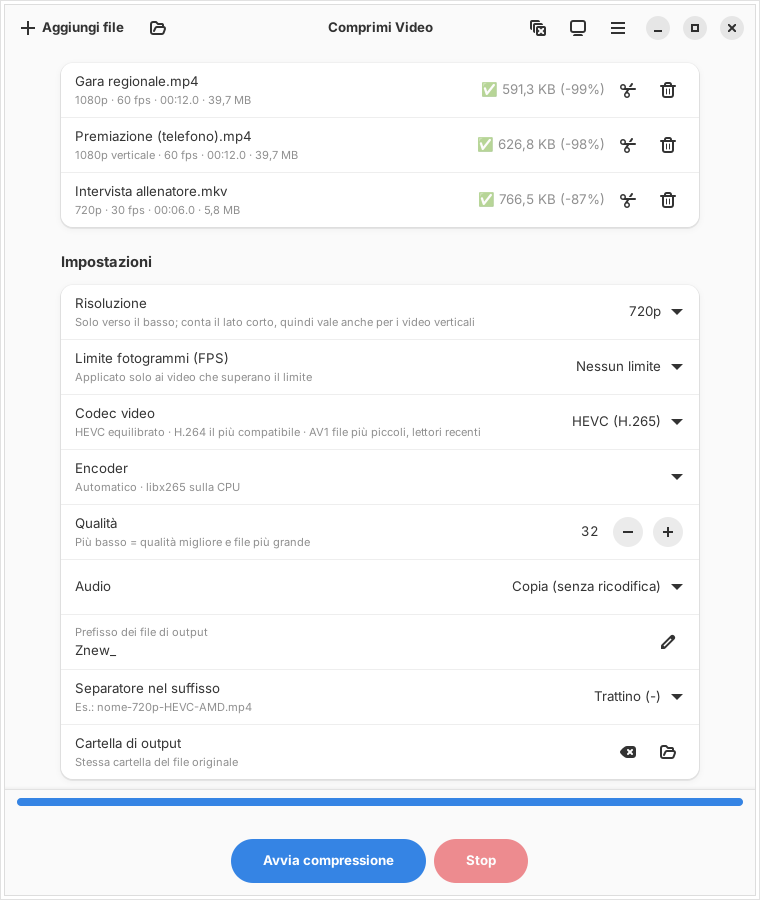
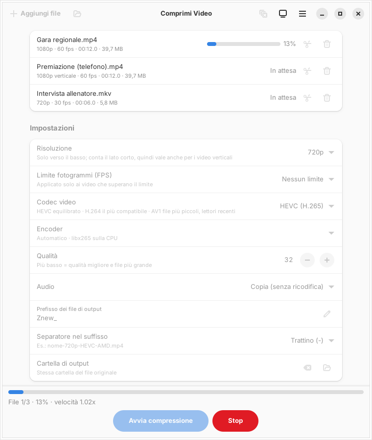

<p align="center">
  
</p>

<h1 align="center">Comprimi Video</h1>

<p align="center">
  Riduce le dimensioni dei video con ffmpeg — HEVC, H.264 o AV1 —<br>
  sulla scheda video (AMD, Intel, NVIDIA) oppure sulla CPU.
</p>

<p align="center">
  <b>Italiano</b> · <a href="README.en.md">English</a>
</p>

<p align="center">
  
</p>

L'interfaccia è in italiano e in inglese: segue la lingua del sistema e si può cambiare
dal menu principale (☰ → Lingua / Language).

## Cosa fa

- **Trova da solo l'hardware**: individua le schede video e prova davvero ogni encoder
  con qualche fotogramma, così usa la GPU quando funziona e la CPU quando non c'è altro.
  Il risultato resta in memoria finché non cambiano driver, schede, ffmpeg o kernel.
- **Tre codec**: HEVC (buon equilibrio), H.264 (il più compatibile), AV1 (file più piccoli).
  Il menu mostra solo quelli che il computer sa produrre.
- **Ridimensiona e limita gli fps** solo verso il basso; la risoluzione conta il lato corto,
  quindi un video verticale del telefono a «720p» diventa 720×1280.
- **Taglia via delle parti** prima di comprimere, con anteprima del risultato.
- **Lavora in serie** su più file o su intere cartelle, anche trascinandoli nella finestra
  o con «Apri con» dal gestore dei file.
- **Sistema l'audio da solo**: lo copia così com'è, oppure lo ricodifica in AAC
  quando il formato originale non va bene in un MP4.

<p align="center">
  
</p>

## Scaricare e installare

Scarica l'AppImage dalla pagina [Releases](https://github.com/cello59-lab/comprimi-video/releases)
e mettila dove preferisci, ad esempio in `~/opt`:

```bash
mkdir -p ~/opt
mv ~/Scaricati/Comprimi_Video-*-x86_64.AppImage ~/opt/
chmod +x ~/opt/Comprimi_Video-*-x86_64.AppImage
~/opt/Comprimi_Video-*-x86_64.AppImage --installa-menu
```

Da quel momento Comprimi Video si apre dal menu delle applicazioni. La voce punta al file
AppImage: se lo sposti, rilancia `--installa-menu`. Per toglierla: `--rimuovi-menu`.

L'AppImage contiene tutto quello che serve (ffmpeg, GTK4, libadwaita, GStreamer):
non bisogna installare nient'altro.

### Requisiti

- Linux x86_64 con **glibc 2.39 o più recente**: Ubuntu 24.04 e successive,
  Linux Mint 22 e successive, Debian 13, Fedora 40 e successive.
- Per la compressione su GPU, i driver della scheda:
  - **AMD e Intel**: driver VA-API (di solito già presenti; su Ubuntu `mesa-va-drivers`
    per AMD, `intel-media-va-driver` per Intel);
  - **NVIDIA**: il driver proprietario (con il driver libero *nouveau* NVENC non è disponibile).

Senza una GPU utilizzabile la compressione avviene sulla CPU: funziona sempre, solo più lentamente.

## Uso

1. Aggiungi i video con **Aggiungi file**, con il pulsante della cartella o trascinandoli nella finestra.
2. Scegli risoluzione, codec e qualità (più basso = qualità migliore e file più grande).
3. Se vuoi, premi le **forbici** su un video per eliminarne delle parti.
4. Premi **Avvia compressione**.

I file prodotti finiscono accanto agli originali (oppure nella cartella scelta) con un nome
che dice cosa è stato fatto, ad esempio `Znew_gara-720p-HEVC-AMD.mp4`
(risoluzione, codec, dove è stato codificato: `AMD`, `INTEL`, `NVENC` o `CPU`).

Il pulsante con il monitor mostra le schede trovate e gli encoder funzionanti,
e permette di ripetere le prove.

## Da terminale

```bash
comprimi-video --rileva                      # schede video ed encoder funzionanti
comprimi-video --cli video.mp4               # comprime senza aprire la finestra
comprimi-video --cli --codec av1 --risoluzione 1080 --fps 30 ~/Video/gara/
comprimi-video --cli --taglia 0:00-0:30 --taglia 9:10-9:50 partita.mp4
comprimi-video --cli --encoder libx265 video.mp4   # forza un encoder
comprimi-video --aiuto                       # tutte le opzioni
```

Ogni opzione ha anche il nome inglese (`--detect`, `--resolution`, `--cut`, `--install-menu`…).
Con l'AppImage si usa allo stesso modo: `Comprimi_Video-*-x86_64.AppImage --rileva`.

## Compilare dai sorgenti

Su Ubuntu 24.04 o successive:

```bash
sudo apt install cargo libgtk-4-dev libadwaita-1-dev ffmpeg libgtk-4-media-gstreamer \
                 gstreamer1.0-plugins-good gstreamer1.0-libav
cargo build --release
./target/release/comprimi-video --installa-menu
```

Serve Rust 1.92 o più recente (con [rustup](https://rustup.rs) se quello della distribuzione è più vecchio).
I test: `cargo test`.

I testi dell'interfaccia sono scritti in italiano nel codice; le traduzioni inglesi sono in
[`src/traduzioni.rs`](src/traduzioni.rs) e `cargo test` segnala i testi nuovi ancora da tradurre.

### Costruire l'AppImage

Lo script [`pacchetto/crea-appimage.sh`](pacchetto/crea-appimage.sh) costruisce l'AppImage
da zero; in testa elenca i pacchetti necessari. FFmpeg (8.1.3) viene compilato dai sorgenti
ufficiali con [`pacchetto/compila-ffmpeg.sh`](pacchetto/compila-ffmpeg.sh), lanciato
automaticamente la prima volta. Va lanciato su Ubuntu 24.04 e usa
[linuxdeploy](https://github.com/linuxdeploy/linuxdeploy) e
[appimagetool](https://github.com/AppImage/appimagetool):

```bash
STRUMENTI=~/strumenti ./pacchetto/crea-appimage.sh
```

## Note

- **Anteprima dei tagli**: viene decodificata sulla CPU. Con alcune combinazioni di driver
  Mesa e GTK la decodifica su GPU di GStreamer mostra artefatti verdi; la compressione
  non ne risente, perché la fa ffmpeg e continua a usare la GPU.
- **libva**: l'AppImage usa quella del sistema, che deve essere allineata ai driver VA-API
  installati; ne contiene una copia di riserva per i sistemi che non ce l'hanno.

## Licenza

Comprimi Video è software libero, distribuito secondo la
[GNU General Public License versione 3 o successiva](LICENSE).

L'AppImage contiene programmi e librerie di terze parti con le loro licenze,
tra cui FFmpeg 8.1.3 (compilato con x264 e x265, quindi GPL), GTK, libadwaita e GStreamer (LGPL).
FFmpeg è compilato dai sorgenti ufficiali, il resto proviene dai pacchetti di Ubuntu 24.04:
i sorgenti corrispondenti sono indicati in [TERZE-PARTI.md](TERZE-PARTI.md).
